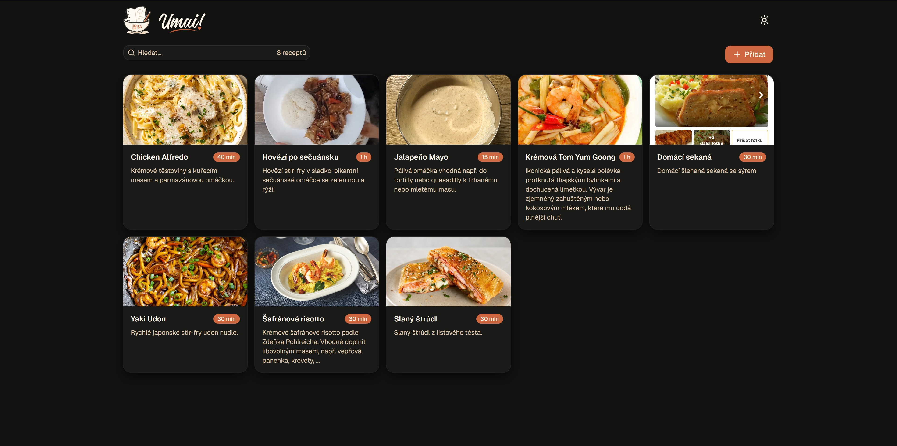
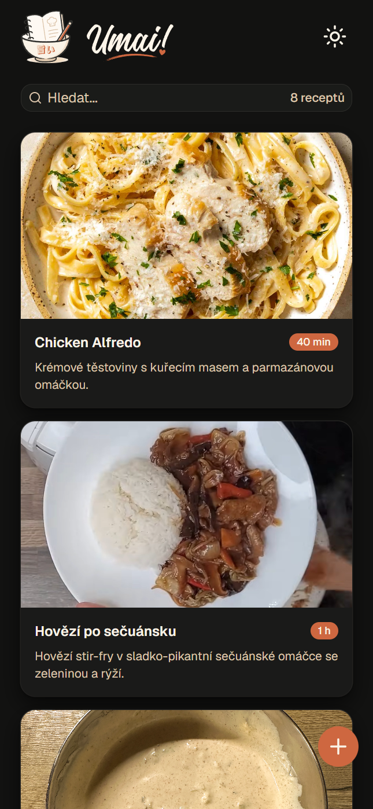
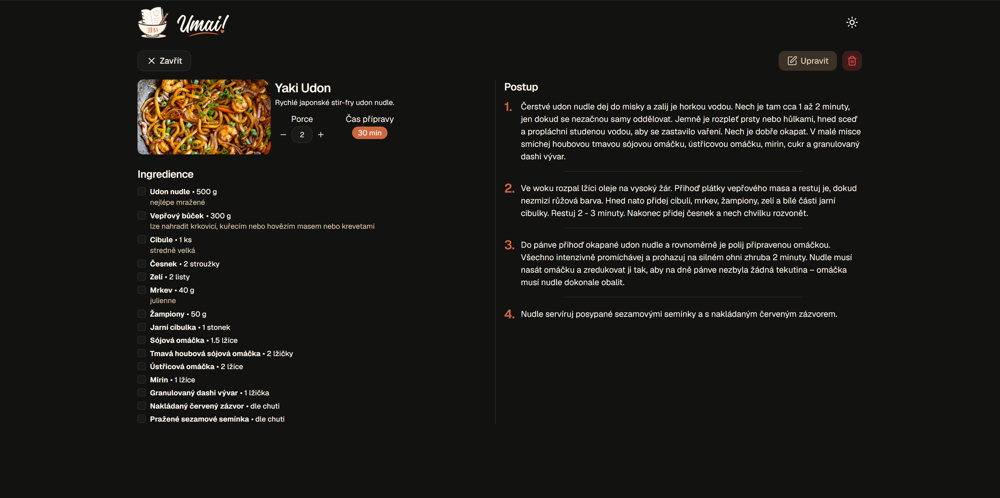
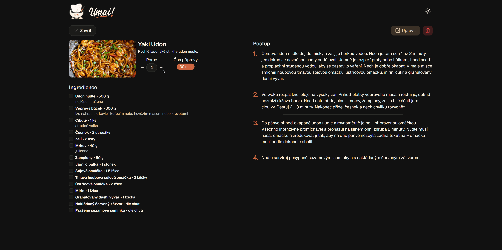
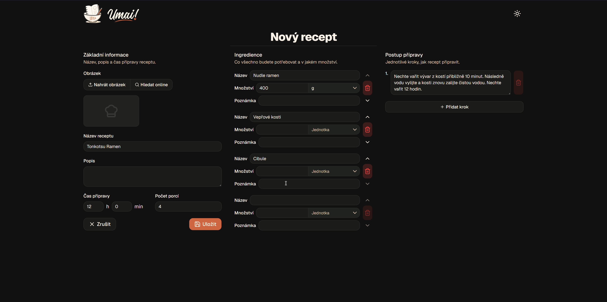
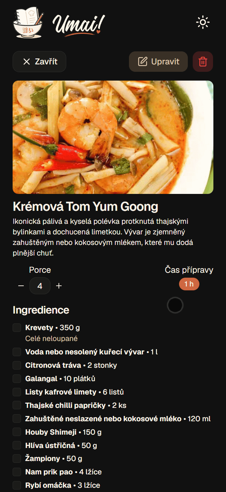
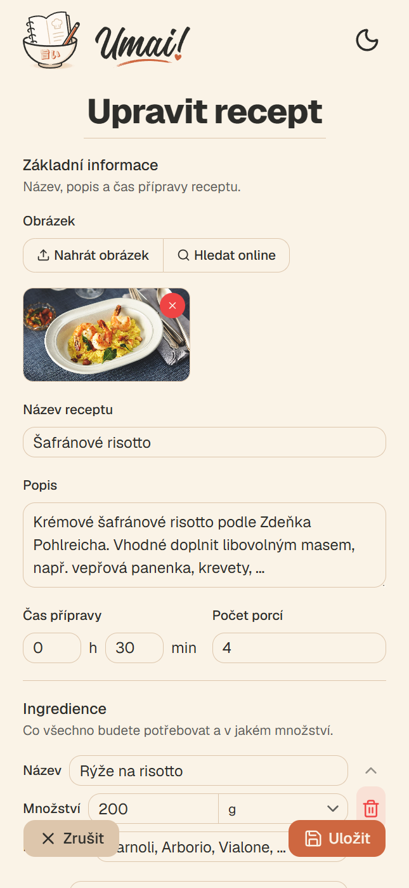
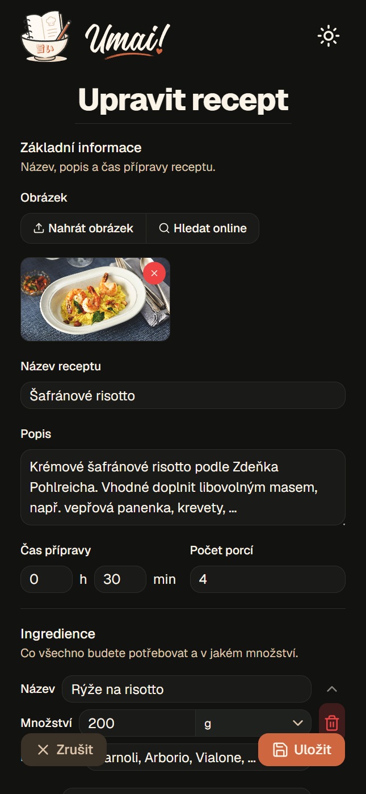

<div align="center">
  
</div>

<div align="center">

**A personal recipe-keeping web app - store recipes with ingredients and step-by-step instructions, scale portions up or down, and browse a clean, mobile-friendly recipe list from your phone. Self-hosted, runs on your own server via Docker.**

Built as a learning project to pick up React and Next.js.

</div>



## Features

- Add, edit, and delete recipes with photos, prep time, and step-by-step instructions
- **Portion scaling** - ingredient amounts recalculate live for any serving count
- Ingredient autocomplete with reorderable ingredient lists
- Photo upload or search (via the [Pexels](https://www.pexels.com/api/) API) with local storage
- Built-in cooking timer with alarm
- Installable as a PWA, with light/dark theme support
- Mobile-first UI, usable one-handed while cooking

## Tech stack

- [Next.js 16](https://nextjs.org/) (App Router) + [React 19](https://react.dev/)
- TypeScript
- [Tailwind CSS v4](https://tailwindcss.com/) + [Radix UI](https://www.radix-ui.com/) primitives, scaffolded via [shadcn/ui](https://ui.shadcn.com/)
- SQLite via [Drizzle ORM](https://orm.drizzle.team/)
- Docker for deployment

## Screenshots & demos

| Recipe list (mobile) | Recipe detail |
| --- | --- |
|  |  |

**Live portion scaling** - ingredient amounts recalculate as you change the serving count:



**Adding a recipe** - form with ingredients and animated reordering:



**Mobile fullscreen recipe view** - always-on ingredients, steps, and the built-in timer while cooking:



Light and dark themes:

| Light | Dark |
| --- | --- |
|  |  |

## Getting started

### Prerequisites

- Node.js 22+
- A [Pexels API key](https://www.pexels.com/api/) (optional, only needed for the photo-search feature)

### Local development

```bash
npm install
cp .env.example .env.local   # add your PEXELS_API_KEY
npm run dev
```

Open [http://localhost:3000](http://localhost:3000). The dev server uses a local SQLite file (`umai.db`) created automatically on first run.

### Running with Docker

```bash
cp .env.example .env  # add your PEXELS_API_KEY
docker compose up -d --build
```

This builds the production image and starts the app on port `3333` (see `docker-compose.yml`), persisting the database and uploaded images in `./data` and `./uploads`.

## Project structure

```
app/            Next.js App Router pages and API routes
components/     React components (recipe form, list, ingredients, UI primitives)
db/             Drizzle schema and database client
drizzle/        Generated SQL migrations
```

## Deployment

`.github/workflows/deploy.yml` redeploys the app to my home server (NAS) via a self-hosted GitHub Actions runner whenever a `v*` tag is pushed - `git fetch`, checkout the tag, and `docker compose up -d --build`.

## License

MIT - see [LICENSE](LICENSE).
